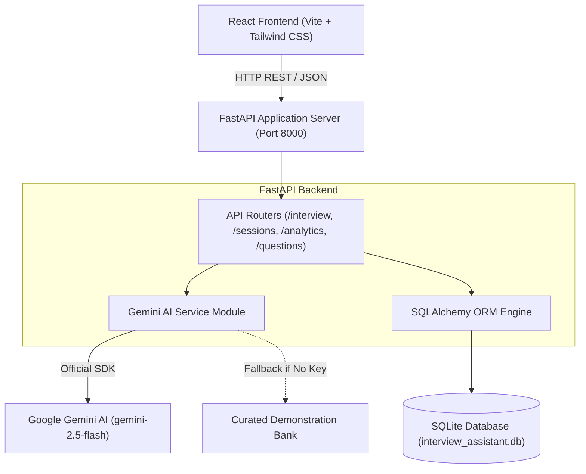

# AI Interview Practice Assistant

> **A Complete Generative AI Technical Interview Preparation Platform for College Students & Beginners**  
> *Academic Year 2024–2026 • College Generative AI Capstone Project*

---

## 👥 Group & Team Information

**Project Group**: Group 11  
**Project Name**: AI Interview Practice Assistant  

| Name | URN | Role |
| :--- | :--- | :--- |
| **Gaurav Mehta** | `2481061` | Full-Stack & Generative AI Lead |
| **Akshay Goel** | `2481031` | Backend & Database Architecture |
| **Jeet Tanwar** | `2481071` | AI Prompt Engineering & Evaluation Rubric |
| **Anshul Kumar** | `2481015` | Frontend UI/UX & Data Analytics |

---

## 🎯 1. Project Objective & Overview

### Objective
The objective is to develop an AI-powered interview preparation platform that helps beginners and university students prepare for entry-level technical interviews.

Traditional interview preparation often feels intimidating and lacks personalized, immediate guidance. **AI Interview Practice Assistant** leverages Generative AI (Google Gemini) to dynamically generate tailored interview questions, evaluate student responses against strict technical rubrics, deliver constructive and supportive feedback, provide model answers, ask follow-up questions, and track long-term performance telemetry.

### Educational Ethics & Guardrails
- **Supportive & Pedagogical**: Evaluates technical meaning without penalizing users for minor grammar mistakes.
- **Strictly Educational**: Explicitly does not claim to predict actual interview outcomes or guarantee job offers.
- **Graceful Fallbacks**: Features dual execution modes—**Live Google Gemini AI Mode** and **Curated Demonstration Mode**—ensuring the application is always demonstration-ready even without an active API key.

---

## 🚀 2. Key Features

1. **AI Question Generation Module**
   - Dynamic generation of technical questions based on selected topic, difficulty (Beginner, Intermediate, Advanced), question count (5, 10, 15), and interview type (Technical, Conceptual, Coding Fundamentals, Mixed).
   - Covers 14+ foundational subjects including Python, Java, C, DBMS, OS, Computer Networks, DSA, SQL, HTML/CSS, JS, React, Cybersecurity, AI, and Machine Learning.
   - Also supports custom topic input for specialized frameworks.

2. **Multidimensional AI Answer Evaluator**
   - Evaluates typed answers on four criteria (each scored 0–10):
     - **Technical Accuracy**
     - **Conceptual Understanding**
     - **Completeness**
     - **Clarity & Explanation**
   - Provides an Overall Score (out of 10) visualized with circular SVG gauges.
   - Generates actionable constructive feedback cards:
     - 🟢 **What You Did Well**
     - 🟡 **Areas to Improve**
     - 🟣 **Missing Important Concepts**
     - 📖 **Improved Sample Answer** (teaching model answers)
     - 💡 **Personalized Learning Recommendation**

3. **AI Follow-up Question Probing**
   - Dynamically analyzes the student's typed answer to generate context-sensitive follow-up questions probing edge cases, scaling behavior, or trade-offs.

4. **Session Summary & Celebratory Feedback**
   - Concludes interview sessions with comprehensive AI mentorship summaries, identifying strongest areas, weakest areas, revision concepts, and celebratory animations (`canvas-confetti`).

5. **SQLite Practice History & Archiving**
   - Persists all practice sessions, attempted questions, word counts, scores, and evaluations.
   - Allows students to review past evaluations or delete sessions at will.

6. **Interactive Performance Analytics**
   - Built with **Recharts** to visualize:
     - Score progression across sessions (Chronological Area Chart)
     - Topic-wise performance comparison (Bar Chart with threshold coloring)
     - Difficulty distribution (Pie Chart)
     - Key telemetry metrics (Average score, Total attempted, Strongest domain, Topics requiring revision)

7. **Question Bank**
   - Full-text search and filtering by technical domain and difficulty.
   - Instant access to model answers and one-click "Practice Topic" shortcuts.

---

## 🛠️ 3. Technology Stack

### Frontend
- **Framework**: React.js 19 with Vite 8
- **Styling**: Tailwind CSS v4 with custom dark SaaS tokens, glassmorphism, and gradient styling
- **Routing**: React Router v7
- **Icons**: Lucide React
- **Data Visualization**: Recharts
- **Celebrations**: Canvas Confetti

### Backend
- **Framework**: FastAPI (Python 3.13)
- **Validation**: Pydantic v2 & Pydantic Settings
- **Server**: Uvicorn ASGI Server
- **Architecture**: REST API with modular routers and dependency injection

### Generative AI
- **Official SDK**: `google-genai` & `google-generativeai`
- **Model**: Configurable Gemini model (`gemini-2.5-flash` or `gemini-1.5-flash`)
- **Output Format**: Structured JSON outputs with Pydantic validation & regex fallback parsers

### Database
- **Engine**: SQLite 3
- **ORM**: SQLAlchemy 2.0 with relational cascading models

---

## 🏗️ 4. System Architecture



---

## 📁 5. Project Folder Structure

```
ai-interview-practice-assistant/
│
├── frontend/                     # React + Vite + Tailwind CSS
│   ├── src/
│   │   ├── components/           # ScoreGauge, AiBadge, Navbar, Sidebar
│   │   ├── layouts/              # MainLayout with background gradient grid
│   │   ├── pages/                # Dashboard, StartInterview, InterviewSession,
│   │   │                         # History, Analytics, QuestionBank, About
│   │   ├── services/             # api.js client
│   │   ├── App.jsx               # React Router configuration
│   │   ├── main.jsx              # Application entry point
│   │   └── index.css             # Tailwind v4 setup & glassmorphism
│   ├── package.json
│   ├── vite.config.js            # Vite configuration with /api proxy
│   └── index.html
│
├── backend/                      # FastAPI Python Application
│   ├── app/
│   │   ├── models/               # SQLAlchemy models (PracticeSession, QuestionRecord)
│   │   ├── schemas/              # Pydantic validation schemas
│   │   ├── services/             # gemini_service.py & sample_data.py
│   │   ├── routes/               # interview, sessions, analytics, questions
│   │   ├── config.py             # App & Gemini configuration
│   │   ├── database.py           # SQLite connection & sessionmaker
│   │   └── main.py               # FastAPI entry point & CORS
│   ├── venv/                     # Python virtual environment
│   ├── requirements.txt          # Python dependencies
│   ├── test_api_flow.py          # End-to-end API test suite
│   ├── .env.example              # Environment variables template
│   └── .env                      # Local environment configuration
│
├── run_backend.bat               # Windows 1-click backend runner
├── run_frontend.bat              # Windows 1-click frontend runner
├── README.md                     # Comprehensive project documentation
└── .gitignore                    # Git ignore file
```

---

## ⚙️ 6. Installation & Setup Instructions

### Prerequisites
- **Node.js**: v18+ (tested on Node v24.13.0)
- **Python**: v3.10+ (tested on Python 3.13.9)
- **OS**: Windows, macOS, or Linux (commands below optimized for Windows PowerShell)

---

### Step 1: Clone or Navigate to the Project

Open **Windows PowerShell** and navigate to the project directory:

```powershell
cd "d:\Gen Ai project"
```

---

### Step 2: Backend Setup & Virtual Environment

1. Navigate to the backend folder:
   ```powershell
   cd backend
   ```

2. Create a virtual environment (if not already created):
   ```powershell
   python -m venv venv
   ```

3. Activate the virtual environment:
   ```powershell
   .\venv\Scripts\Activate.ps1
   ```

4. Install backend dependencies:
   ```powershell
   pip install -r requirements.txt
   ```

5. Configure your Gemini API Key:
   - Copy `.env.example` to `.env`:
     ```powershell
     Copy-Item .env.example .env
     ```
   - Open `.env` in any text editor and add your key:
     ```env
     GEMINI_API_KEY=AIzaSy...your_gemini_api_key_here
     GEMINI_MODEL=gemini-2.5-flash
     ```
   > 💡 *Note: If you do not have an API key right now, leave it blank! The application will automatically run in **Curated Demonstration Mode**, allowing you to present all features and test questions without error.*

6. Start the FastAPI backend server:
   ```powershell
   .\venv\Scripts\uvicorn app.main:app --host 127.0.0.1 --port 8000 --reload
   ```
   *The backend will be live at `http://127.0.0.1:8000` (Interactive Swagger docs at `http://127.0.0.1:8000/docs`).*

---

### Step 3: Frontend Setup

Open a **second Windows PowerShell terminal window**:

1. Navigate to the frontend folder:
   ```powershell
   cd "d:\Gen Ai project\frontend"
   ```

2. Install npm dependencies:
   ```powershell
   npm install
   ```

3. Start the Vite development server:
   ```powershell
   npm run dev
   ```

4. Open your web browser and navigate to:
   ```
   http://127.0.0.1:5173/
   ```

---

## 🧪 7. Running Automated API Tests

To verify that all 9 API endpoints, SQLite queries, and AI pipelines are functioning properly:

```powershell
cd "d:\Gen Ai project\backend"
.\venv\Scripts\python test_api_flow.py
```

Expected output:
```
=== STARTING FULL API WORKFLOW VALIDATION ===
[1] Testing /api/health... -> PASS
[2] Testing /api/interview/generate... -> PASS
[3] Testing /api/interview/evaluate... -> PASS
[4] Testing /api/interview/follow-up... -> PASS
[5] Testing /api/interview/summary... -> PASS
[6] Testing /api/sessions/{session_id}... -> PASS
[7] Testing /api/analytics... -> PASS
[8] Testing /api/questions... -> PASS
[9] Testing DELETE /api/sessions/{session_id}... -> PASS
==========================================
ALL 9 BACKEND ENDPOINTS AND WORKFLOWS PASSED!
==========================================
```

---

## 📡 8. REST API Endpoint Reference

| Method | Endpoint | Description |
| :--- | :--- | :--- |
| `GET` | `/api/health` | Health check endpoint returning runtime status and Gemini API state |
| `POST` | `/api/interview/generate` | Generates technical interview questions via Gemini and creates a session |
| `POST` | `/api/interview/evaluate` | Evaluates a typed response across 4 criteria with constructive feedback |
| `POST` | `/api/interview/follow-up` | Generates a contextual follow-up question based on the student's answer |
| `POST` | `/api/interview/summary` | Synthesizes an overall session review with strengths, weaknesses, and revision tips |
| `GET` | `/api/sessions` | Lists all practice sessions ordered by most recent |
| `GET` | `/api/sessions/{session_id}`| Retrieves complete question records, answers, and evaluations for a session |
| `DELETE`| `/api/sessions/{session_id}`| Deletes a practice session from SQLite |
| `GET` | `/api/analytics` | Calculates aggregate performance metrics and telemetry |
| `GET` | `/api/questions` | Searches and filters the Question Bank with model answers |

---

## 📸 9. Application Previews & Screenshots

### Dashboard
The primary landing hub showcasing practice statistics, score progression area chart, quick start actions, and 14 technical topic shortcuts.

### AI Interview Practice Module
Interactive question view featuring question metadata, monospace answer editor, real-time word counter, and one-click submission.

### Multi-Criterion Evaluation Card
Visual score gauges breakdown for Technical Accuracy, Conceptual Understanding, Completeness, and Clarity, alongside structured feedback cards and collapsible model answers.

### Performance Analytics
Comprehensive dashboard displaying historical score trajectories, domain comparisons, and difficulty distributions powered by Recharts.

---

## 🎓 10. College Project Presentation Highlights

When demonstrating this project to professors, evaluators, or classmates:
1. **Highlight the Educational Philosophy**: Emphasize that the AI is guided by strict system prompts to avoid punitive grading over minor spelling errors, focusing on genuine technical clarity.
2. **Demonstrate Both Modes**: Show the **AiBadge** in the navigation bar. Explain how seamless fallback ensures zero downtime while allowing instant live Gemini AI activation when an API key is provided.
3. **Show SQLite Persistence**: Show how answering questions updates the real SQLite database and immediately reflects on the **Analytics** and **Practice History** pages.
4. **Walk Through the 4-Criteria Rubric**: Explain why evaluating Technical Accuracy, Conceptual Understanding, Completeness, and Clarity separately provides far more value than a single arbitrary score.

---

*AI Interview Practice Assistant • College Generative AI Project • Group 11*
